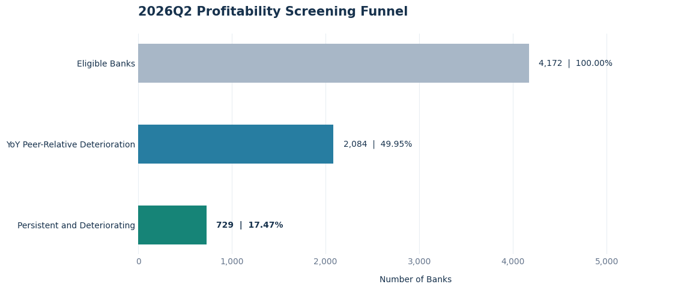
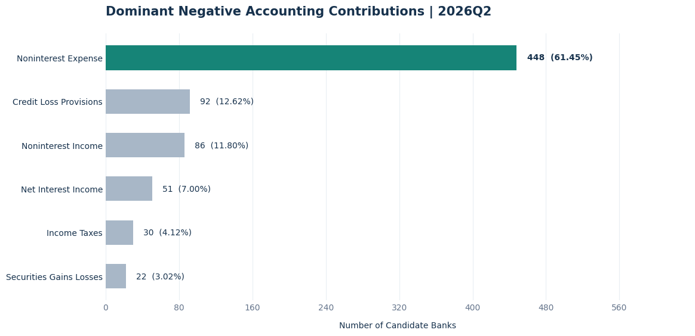
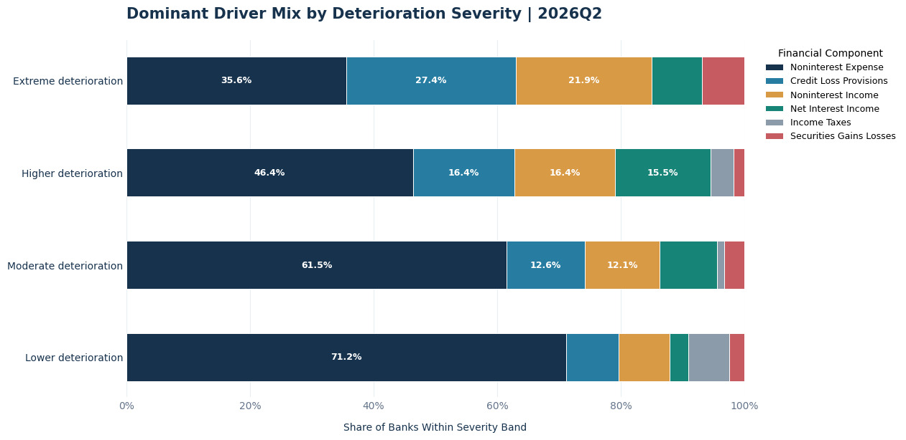
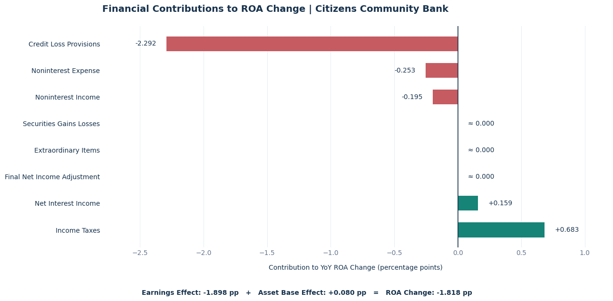
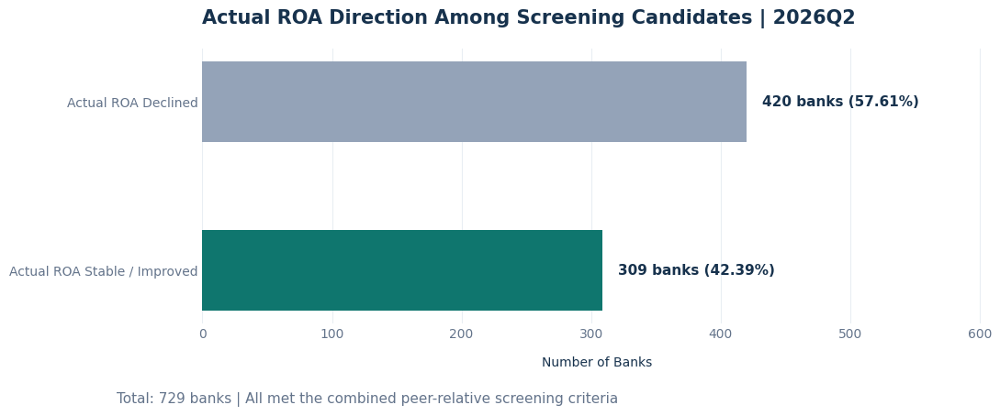

# Bank Profitability Diagnostics

**End-to-End Financial Data Analytics Project | Python · REST API · Databricks**

## Project Overview

This project examines profitability performance across U.S. banking institutions, identifies banks experiencing persistent underperformance relative to comparable peers, and investigates the accounting contributions associated with changes in profitability.

Using quarterly financial data retrieved from the Federal Deposit Insurance Corporation (FDIC) REST API, the analysis develops a peer benchmarking framework based on bank asset size and real estate lending concentration.

The project combines historical data validation, profitability screening, accounting-based ROA decomposition, and management-oriented financial diagnostics.

**The focus is on historical profitability analysis and management review prioritisation, rather than financial distress prediction or regulatory risk assessment.**

## Business Questions

1. Which banks consistently report profitability below their comparable peer-group median?
2. Which institutions experience deteriorating peer-relative profitability?
3. Which financial statement components contribute most to bank-level ROA changes?
4. How do dominant negative accounting contributions differ across deterioration severity levels?
5. Which banks should be prioritised for further financial investigation?

## Tools & Technologies

- **Python:** Financial data processing, validation, peer benchmarking, and analytical modelling.
- **Pandas & NumPy:** Data transformation, quarterly financial calculations, and statistical analysis.
- **REST API:** Automated extraction of FDIC historical financial and institution data, including pagination and request handling.
- **PySpark & Delta Lake:** Historical data storage, snapshot consistency checks, and data integrity validation.
- **Databricks:** Notebook development, execution, and analytical data management.
- **Matplotlib:** Financial diagnostics and executive-level visualizations.

## Data Sources

- **FDIC BankFind Financials API:** Quarterly financial statements and loan portfolio information.
- **FDIC BankFind Institutions API:** Institution reference data and bank identification.

**Analytical coverage:**

| Metric | Coverage |
|---|---:|
| Reporting period | 2022Q1-2026Q2 |
| Reporting quarters | 18 |
| Raw bank-quarter observations | 83,041 |
| Banking institutions | 4,908 |
| Eligible profitability observations | 82,735 |
| Eligible institutions after data-quality exclusions | 4,891 |

The project uses historical Delta snapshots to preserve a consistent analytical dataset and documents differences detected between stored snapshots and subsequent FDIC API extractions.

Official data source: [FDIC BankFind Suite](https://banks.data.fdic.gov/)

## Key Findings

### Peer-Relative Profitability Screening - 2026Q2

| Screening Metric | Banks | Share |
|---|---:|---:|
| Eligible for year-over-year peer comparison | 4,172 | 100.00% |
| Peer-relative profitability deterioration | 2,084 | 49.95% |
| Combined-screening candidates | **729** | **17.47%** |

The combined screening identifies banks that experienced both persistent peer underperformance and year-over-year deterioration relative to their peer benchmarks.

### Actual vs. Peer-Relative Profitability

Among the 729 selected banks:

- **420 banks (57.61%)** experienced an actual year-over-year ROA decline.
- **309 banks (42.39%)** maintained or improved their actual ROA despite deteriorating relative to peers.

This distinction demonstrates why peer-relative benchmarking provides information beyond standalone profitability measures.

### Dominant Negative Accounting Contributions

| Accounting Component | Banks | Share of Candidates |
|---|---:|---:|
| Noninterest Expense | 448 | 61.45% |
| Credit Loss Provisions | 92 | 12.62% |
| Noninterest Income | 86 | 11.80% |
| Net Interest Income | 51 | 7.00% |

Noninterest Expense was the most frequently identified largest negative accounting contribution.

However, the distribution of dominant negative contributions differed across deterioration severity bands. Credit Loss Provisions and Noninterest Income were relatively more prevalent in the Extreme deterioration group than in the Lower deterioration group.

These frequencies describe which component was the largest negative contributor for each bank. They do not measure aggregate losses or establish causality.

### Financial Reconciliation & Robustness

The accounting-based ROA bridge reconciled year-over-year ROA changes for all **729 selected banks**.

A sensitivity analysis excluding 16 observations outside the 1st-99th percentile range of actual ROA changes preserved the leading rankings of dominant negative accounting contributions.

The primary screening population remained unchanged.

## Methodology - End-to-End Analytical Workflow

### Phase 1 - FDIC API Extraction & Data Quality

- Extract quarterly financial statements and institution reference data through FDIC REST APIs.
- Validate reporting periods, unique bank-quarter identifiers, and financial field availability.
- Assess missing values, reporting continuity, and accounting relationships.
- Apply documented profitability eligibility rules.
- Preserve historical financial and loan portfolio snapshots in Delta Lake.

### Phase 2 - Financial Metrics & Peer Group Design

- Convert year-to-date income statement amounts into individual quarterly values.
- Estimate annualized quarterly ROA using quarterly net income and two-point average assets.
- Develop and assess loan portfolio composition ratios.
- Select asset size and real estate loan concentration as peer-group dimensions.
- Validate peer-group coverage, minimum group sizes, and historical membership stability.

The final framework contains **12 peer groups**, combining four asset-size bands with three real estate loan share bands.

### Phase 3 - Peer-Relative Profitability Screening

- Calculate quarterly median estimated ROA for each peer group.
- Measure each bank's ROA gap relative to its peer-group median.
- Identify banks with four consecutive quarters of negative peer-relative ROA gaps.
- Evaluate year-over-year deterioration in peer-relative profitability.
- Combine both conditions to identify banks requiring further financial diagnosis.

### Phase 4 - Accounting-Based Financial Diagnosis

- Decompose year-over-year ROA changes into Earnings Effect and Asset Base Effect.
- Reconcile the Earnings Effect with income statement component contributions.
- Identify each bank's dominant negative accounting contribution.
- Compare financial contribution patterns across deterioration severity bands.
- Perform outlier sensitivity checks and validate accounting reconciliation.

### Phase 5 - Executive Reporting & Management Review

- Visualize the profitability screening funnel.
- Summarize dominant negative financial contributions.
- Compare accounting driver composition across severity groups.
- Present an illustrative bank-level ROA bridge.
- Develop a ranked management review shortlist.
- Distinguish actual ROA declines from peer-relative deterioration.

Together, these phases form an integrated workflow from **FDIC API extraction to management-oriented financial diagnostics**.

## Project Structure

Current repository:

```text
bank-profitability-diagnostics/
├── README.md
├── bank_profitability_diagnostics.ipynb
├── images/
│   ├── .gitkeep
│   ├── 01_screening_funnel.png
│   ├── 02_dominant_drivers.png
│   ├── 03_severity_comparison.png
│   ├── 04_roa_bridge.png
│   └── 05_actual_roa_direction.png
└── reports/
    ├── .gitkeep
    └── Bank_Profitability_Diagnostics_Python.pdf
```

The notebook contains the full analytical workflow, saved execution results, validation checks, and visualizations.

## Python Visualization Preview

The following visualizations summarise the principal findings from the completed Python analysis.

### 1. Profitability Screening Funnel

Shows the progression from 4,172 eligible banks to 2,084 banks with peer-relative deterioration and 729 combined-screening candidates.



### 2. Dominant Negative Financial Drivers

Compares the frequency of accounting components identified as each selected bank's largest negative contribution.



### 3. Severity-Based Driver Comparison

Illustrates how dominant accounting contribution patterns differ across deterioration severity bands.



### 4. Illustrative Bank-Level ROA Bridge

Demonstrates how changes in earnings and average assets contribute to the year-over-year ROA change of a selected institution.



### 5. Actual ROA Direction

Compares the 420 banks with actual ROA declines against the 309 banks whose ROA remained stable or improved despite peer-relative deterioration.


  
## Project Status - Completed

- [x] FDIC API data extraction and historical snapshot validation
- [x] Financial data quality assessment
- [x] Quarterly profitability metrics preparation
- [x] Peer-group design and historical validation
- [x] Persistent underperformance and deterioration screening
- [x] Accounting-based ROA earnings bridge
- [x] Financial driver and severity analysis
- [x] Robustness and reconciliation checks
- [x] Executive visualizations and management review shortlist

## Limitations

- Peer groups are based on asset size and real estate lending concentration and do not capture every dimension of bank similarity.
- Peer-group thresholds were calibrated using the 2026Q2 reference period and applied retrospectively.
- Estimated annualized quarterly ROA is not identical to FDIC-reported ROA.
- Accounting decomposition identifies financial contributions but does not establish their operational causes.
- Severity classifications and management review rankings are project-defined analytical tools, not regulatory risk assessments.
- The results reflect the historical data snapshot and may differ from analyses using subsequently revised FDIC data.
- Historical profitability deterioration should not be interpreted as a prediction of future financial distress.

## Reports & Documentation

Detailed analytical materials are available below:

- [Python Analysis Report](reports/Bank_Profitability_Diagnostics_Python.pdf)
- [Complete Python Analysis Notebook](bank_profitability_diagnostics.ipynb)

The PDF report provides the complete analytical methodology, supporting calculations, validation results, visualizations, and financial interpretations.

The Jupyter notebook contains the underlying Python code and saved execution outputs.
  
For a concise review of the findings, see **Section 08 - Executive Insights & Visualizations**.

## Execution Environment & Reproducibility

The project was developed and executed using Python in Databricks.

### Data Requirements

- Access to FDIC BankFind API endpoints.
- A compatible Databricks environment with the required Python libraries.
- Appropriate permissions for creating or accessing Delta tables.

### Execution Workflow

1. Configure the Databricks environment and required data storage locations.
2. Review the FDIC API extraction parameters and historical reporting period.
3. Execute the notebook sequentially to retrieve, validate, and prepare the financial data.
4. Run peer-group benchmarking, profitability screening, and accounting diagnostics.
5. Review validation results, financial reconciliations, and executive visualizations.

### Reproducibility Notes

- The notebook contains Databricks-specific storage and execution logic.
- Historical Delta snapshots used for the published results are not included in this repository.
- Subsequent FDIC API extractions may contain revised records.
- Reproducing the exact published figures requires the corresponding historical snapshots and compatible environment.
- The saved notebook outputs document the completed analytical run.

## Author

**Minh Khanh Trinh**

Aspiring Data Analyst | Python · Financial Analytics · Data Engineering

[GitHub Profile](https://github.com/minhkhanh-trinh3196)

## Copyright Notice

© 2026 Minh Khanh Trinh. All rights reserved.

Original project code, analytical documentation, and visualizations are presented for portfolio demonstration purposes.

Third-party data and materials remain subject to their respective ownership, licensing, and usage terms.
